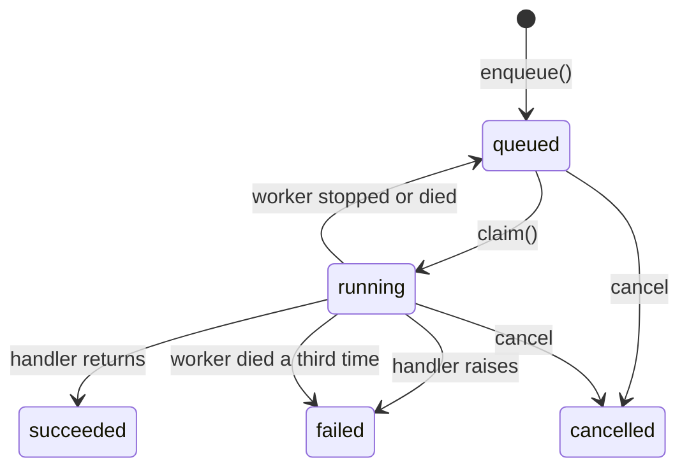

# Worker

Runs the background jobs queued in the `jobs` table. It's a separate process from the API and is started with `python -m app.main --worker`.

## Components

| File                     | Role                                                                                                                                                                    |
| ------------------------ | ----------------------------------------------------------------------------------------------------------------------------------------------------------------------- |
| [queue.py](queue.py)     | The queue is the `jobs` table. `enqueue` adds a job, `claim` takes the next one, `recover_orphans` requeues jobs whose worker died, `update_job` writes status and log. |
| [worker.py](worker.py)   | `Worker` loop: claims one job at a time, runs its handler, watches for cancel requests, and records how the job ended.                                                  |
| [context.py](context.py) | `JobContext`, passed to handlers to write log lines and progress. `JobError`, raised by handlers for errors the user should see.                                        |
| [handlers/](handlers/)   | One `Handler` subclass per job type, which validates the job's `params` and does the work.                                                                              |

## How a job runs

1. The API (or a script) calls `enqueue()`, which inserts a `queued` job.
2. The worker's `claim()` takes the oldest queued job, takes its advisory lock and marks it `running`, in one transaction.
3. `_execute()` looks up the handler for the job's type and runs it. The handler validates the `params`, does the work, and reports through `context.log()` and `context.progress()`.
4. While the handler runs, `_watch()` checks every `poll_interval` whether a user asked to cancel the job.
5. When the handler ends, the worker records the outcome (status, result or error), then closes the job's connection, which releases the lock.

A job's status changes like this:

Status changes are triggered by these events:
- Cancel: `POST /jobs/{id}/cancel` cancels a queued job. For a running job it sets `cancel_requested_at`. `_watch` sees it and stops the handler.
- Stop (SIGTERM, SIGINT): the running handler is stopped and the job is queued again.
- Crash: Postgres releases the advisory lock with the dead connection. `recover_orphans` (at start and every minute) finds `running` jobs it can lock and queues them again, or fails them after `MAX_RESTARTS`.

## Advisory locks

A Postgres [advisory lock](https://www.postgresql.org/docs/current/explicit-locking.html#ADVISORY-LOCKS) is simply a lock on a 64-bit (or two 32-bit) integer. It can be session-level (held until the connection closes) or transaction-level (held until the transaction commits). They are not tied to any table or row, so they don't block normal queries.

In our case, a session-level lock is released automatically when its connection closes, also when the process dies (crash, `kill -9`, out of memory). The worker holds the lock of the job it runs on a connection it keeps open until the job ends. So a job that's `running` but whose lock is free belongs to a dead worker.

As the key, we use two 32-bit integers, `(JOB_LOCK_CLASS, job_id)`. `JOB_LOCK_CLASS` (in [queue.py](queue.py)) is an arbitrary fixed number that marks the lock as a job lock, so it can't clash with other advisory locks in the same database. It must stay the same across deploys. The `job_id` is the job's primary key, so each job has its own lock.

A lock is acquired at two places:
- `claim` takes a session-level lock (`pg_try_advisory_lock`), held until the job's connection closes.
- `recover_orphans` takes transaction-level locks (`pg_try_advisory_xact_lock`), released at its commit.
