# NetCDF inspection

Inspection reads one NetCDF file and suggests the dataset's feature type and variables, with warnings for anything the build would reject or that needs a decision.

| Where                                                                                 | What                                                                                                                                                                                                                                                                                            |
| ------------------------------------------------------------------------------------- | ----------------------------------------------------------------------------------------------------------------------------------------------------------------------------------------------------------------------------------------------------------------------------------------------- |
| [`app/inspection.py`](../app/inspection.py)                                           | The rules below. `inspect_file(path)` reads the file.                                                                                                                                                                                                                                           |
| [`app/matching.py`](../app/matching.py)                                               | `guess_parameters(result, parameters)` fills in `parameter_id`, see [Parameter](#parameter-parameter_id).                                                                                                                                                                                       |
| `POST /datasets/{dataset_id}/inspect` ([`app/routes/sync.py`](../app/routes/sync.py)) | Checks that the file is in the dataset's archive (the first file by path if none is given), reads it in a thread with a 10 s limit (504 `inspect_timeout`), and guesses parameters from the `parameters` table. The response is `InspectResult` in [`docs/api/openapi.yaml`](api/openapi.yaml). |
| [`scripts/inspect_netcdf.py`](../scripts/inspect_netcdf.py)                           | The same for a local file, without a database. Parameters are guessed from `scripts/seed_data/parameters.json`, written by `scripts/seed_dummy_data.py --export-parameters`.                                                                                                                    |

```console
uv run python -m scripts.inspect_netcdf path/to/file.nc            # readable report
uv run python -m scripts.inspect_netcdf path/to/file.nc --json     # what the endpoint returns
uv run python -m scripts.inspect_netcdf path/to/file.nc --parameters ""   # without guessing parameters
```

```mermaid
flowchart TD
  A["inspect_file(path)"] --> B{"ends with .nc?"}
  B -- no --> E1["ApiError 422 unreadable_file"]
  B -- yes --> C["xr.open_dataset<br/>(no decoding of time, scale or fill values)"]
  C -- fails --> E1
  C -- ok --> L

  subgraph L ["For each variable"]
    direction TB
    V1["_axis: time, vertical, latitude, longitude or none<br/>(name, standard_name, axis, units)"] --> V2{"has a dimension?"}
    V2 -- "no (scalar)" --> V3["keep as scalar<br/>(e.g. depth = 1000 cm)"]
    V2 -- yes --> V4["_sample: up to ~100,000 evenly spaced values"]
    V4 --> V5["_missing_values: suggested decoding<br/>(-9999, values above 1e31, inf) and sample stats"]
    V5 --> V6["_role: time, then flag, then coordinate, else data"]
    V6 -- time --> V7["_time_range: CF units? first and last time,<br/>repeated or decreasing values"]
    V6 -- "flag, coordinate, data" --> V8["warn: placeholders, empty variable,<br/>almost-zero values, not numeric"]
    V7 --> V9
    V8 --> V9["_unit: units string<br/>(warn if it's a list)"]
    V9 --> V10{"flag with meanings<br/>in units?"}
    V10 -- yes --> V11["unit = none<br/>(the meanings stay in attributes)"]
    V10 -- no --> V12
    V11 --> V12["_suggest_name and add the suggestion"]
  end

  L --> F1["_link_flags: set flag_for<br/>(ancillary_variables, else temp_qual → temp)"]
  F1 --> F2["_check_unit_spelling: mg/l vs mg/L"]
  F2 --> F3["warn: dimension without coordinate,<br/>no time variable or no ISO 8601 time attribute"]
  F3 --> F4["_feature_type"]

  subgraph FT ["_feature_type, first match wins"]
    direction TB
    T0["warn about dimensions that are neither time nor depth"] --> T1{"featureType<br/>attribute?"}
    T1 -- valid --> R0["declared type"]
    T1 -- "missing or invalid" --> T2{"time and depth vary<br/>along the same dimension?"}
    T2 -- yes --> R1["profile (one cast)"]
    T2 -- no --> T3{"data on time<br/>and depth?"}
    T3 -- yes --> R2["timeSeriesProfile"]
    T3 -- no --> T4{"data on time?"}
    T4 -- yes --> R3["timeSeries"]
    T4 -- no --> T5{"data on depth?"}
    T5 -- yes --> R4["profile"]
    T5 -- no --> R5["none + warning"]
  end

  F4 --> FT
  FT --> F5["time order warning<br/>(skipped for profiles)"]
  F5 --> F6["_location: latitude and longitude from<br/>scalar variables or global attributes"]
  F6 --> F7["warn if no latitude and longitude"]
  F7 --> OUT["InspectResult: time and coordinates first"]
  OUT --> G["guess_parameters (endpoint and script):<br/>parameter_id from the vocabulary"]
```



## How the file is read

1. Only `.nc` files are accepted. Anything else or a file that can't be opened results in an `unreadable_file` error.
2. The file is opened with xarray without decoding (`decode_times=False`, `mask_and_scale=False`), so the raw values and attributes are visible.
3. Every variable is read as a sample of at most about 100,000 values, evenly spaced over all dimensions. Smaller variables are read whole.
4. Variables without a dimension (scalars, e.g. `depth = 1000 cm` on a mooring) are returned in `scalars` but not suggested, because a variable needs at least one dimension.

## Rules

The rules are heuristics: they look at names, attributes and a sample of values. They make suggestions, so a user still reviews the result before the variables are created. Where a rule can't decide, it warns instead of guessing.

### Axis

Each variable is first checked for what it describes: time, a vertical position, latitude or longitude. The axis decides the role and the feature type below. It's taken from the variable's name, `standard_name`, `axis` and `units`. Names are compared in lower case.

| Axis                | Recognised by                                                                                                                                                                                   |
| ------------------- | ----------------------------------------------------------------------------------------------------------------------------------------------------------------------------------------------- |
| time                | name or `standard_name` `time`, `axis = "T"`, or units like `<unit> since <date>`                                                                                                               |
| vertical            | `depth`, `pressure`, `press`, `pres`, `altitude`, `height`, `z`, `level`, `lev`; `axis = "Z"`; a `positive` attribute; or a dimension coordinate whose name contains `depth` (e.g. `avg_depth`) |
| latitude, longitude | `latitude`, `lat`; `longitude`, `lon`, `long`, `lng`                                                                                                                                            |

### Role

Every variable gets one of the four roles of the `variables` table. They're checked in this order (first match wins):

1. **time**: the time axis.
2. **flag**: has `flag_values`, `flag_masks` or `flag_meanings`, or its name contains `flag`, `qa`, `qc`, `qual` or `quality` as a word (`temp_qual`).
3. **coordinate**: any other axis, a dimension coordinate (`depth(depth)`), or listed in the file's coordinates.
4. **data**: everything else.

### Suggested fields

Each variable that has at least one dimension becomes a suggestion with the fields of a variable. `source_name` is always the exact name in the file, so the build can find it again. The other fields are filled as follows:

| Field          | Rule                                                                                                                                                                        |
| -------------- | --------------------------------------------------------------------------------------------------------------------------------------------------------------------------- |
| `name`         | The file's name in lower case, other characters replaced by `_`, prefixed with `v_` if it doesn't start with a letter, made unique with `_2`, `_3`… (`O2-sat` → `o2_sat`)   |
| `unit`         | The `units` attribute. None for time and for flags whose units hold their meanings.                                                                                         |
| `description`  | `long_name`                                                                                                                                                                 |
| `flag_for`     | The data variable a flag belongs to: from the data variable's CF `ancillary_variables`, otherwise by name (`temp_qual` → `temp`). Flags on `time` or `depth` aren't linked. |
| `decoding`     | See below. Never set for time.                                                                                                                                              |
| `parameter_id` | Guessed from the `parameters` vocabulary, see below.                                                                                                                        |
| `detail`       | Not guessed, always `null`. Set it by hand to tell apart variables of the same parameter, e.g. `at 2m` and `at 4m`.                                                         |

### Parameter (`parameter_id`)

Done by [`app/matching.py`](../app/matching.py). The variable's `standard_name`, `long_name` and name in the file are compared with each parameter's name, `cf_name` and translations (`name_de`, `name_fr`, `name_it`). Each parameter gets a score from 0 to 100 for its best match:

- **100**: the `standard_name` is the parameter's `cf_name` (without case, spaces or punctuation, so `Water_Temperature` matches `water_temperature`).
- **up to 95**: a fuzzy match of the names. Before comparing, the variable's name is read in two ways, and the better one counts:
  - as written, e.g. `pH`,
  - with camelCase split, abbreviations spelled out and units, statistics and heights dropped, e.g. `AirTC_2m` -> "air temperature", `WS_ms_Avg` -> "wind speed", `Rain_mm_Tot` → "rainfall".

  The score is the average of [rapidfuzz](https://rapidfuzz.github.io/RapidFuzz/)'s `token_sort_ratio`, which penalises extra words, and `token_set_ratio`, which doesn't. So "Air temperature at 2m" still matches Air Temperature, and "wind" matches Wind Speed better than Wind Speed Gust.

The best parameter is always set, even if the match is weak. If several parameters share the best score, the one with the lowest id is set.

### Missing values (`decoding`)

Many older files mark missing values with a placeholder instead of NaN or a declared `_FillValue`. If these aren't removed, a `-9999` ends up in a plot as a real temperature. The suggested `decoding` tells the build which values to turn into NaN, so all stored data uses one convention.

Values declared as `_FillValue` or `missing_value`, and NaN, are already missing. In the sample, inspection also looks for:

- `-9999`, `-999` or `-99999` → `"missing_values": [...]`
- values above `1e31`, including `inf` and the NetCDF default fill (9.97e36) → `"valid_max": 1e31`
- non-zero values smaller than `1e-20` (e.g. `-9.99e-29`) → a warning only, since they might be real

Because only a sample is read, a placeholder that occurs rarely can be missed.

### Feature type

The feature type describes the shape of the whole dataset and decides how the API queries and plots it: a line over time, a heatmap over time and depth, or separate casts. It's derived from the dimensions of the time and vertical coordinates and of the data variables. The first matching rule wins:

1. A CF `featureType` global attribute, if it's `timeSeries`, `timeSeriesProfile` or `profile`.
2. **profile**: time and depth vary along the same dimension, i.e. one cast per file (`depth(time)`, `time(depth)`, `time(Press)`).
3. **timeSeriesProfile**: a data variable is on both a time and a vertical dimension (`temp(depth, time)`).
4. **timeSeries**: data on time without a vertical dimension.
5. **profile**: data on a vertical dimension without time.
6. Otherwise no suggestion.

### Time

Time is the axis every dataset is queried and partitioned by, so it gets the strictest checks.

- Time must have CF units (`seconds since 1970-01-01 00:00:00`). Without them, the warning is `invalid_time_units` and the build will reject the file. The warning says how the old API would have guessed: values below 31,536,000 as MATLAB datenums, otherwise as unix seconds.
- The first and last time are decoded from the units and `calendar` and returned in `time_range`.
- In a time series, repeated or decreasing times are reported. In a cast they're normal and ignored.
- A file without a time variable needs its time in a global attribute (`time`, `datetime`, `date`, `start_time` or `time_coverage_start`) as an ISO 8601 string. Otherwise there's a warning.

### Other warnings

These don't change the suggestion, but point at something to fix in the file or to decide at review:

- `units` stored as a list (`['degC', 'C']`) instead of a string
- `units` holding flag meanings (`0 = nothing to report, 1 = more investigation`)
- the same unit spelled differently in one file (`mg/l` and `mg/L`)
- a variable with no valid values in the sample
- non-numeric values
- a dimension without a coordinate variable
- a dimension that is neither time nor depth (e.g. `wavelength`); only time and depth are supported
- no latitude and longitude anywhere in the file

## Best practices for NetCDF files

Files that follow these rules need no corrections at setup and pass the build's checks.

- **Follow CF**: set the global attribute `Conventions = "CF-1.11"` (capital C) and `featureType` (`timeSeries`, `timeSeriesProfile` or `profile`).
- **Time**: a `time` coordinate with CF units, e.g. `units = "seconds since 1970-01-01 00:00:00"`, `calendar = "standard"`, in UTC, strictly increasing, without duplicates across files.
- **Depth**: a `depth` coordinate in metres with `positive = "down"`. Store values at several depths on one `depth` dimension, not as separate variables like `temp_1m` and `temp_15m`.
- **Location**: `latitude` and `longitude` (decimal degrees, WGS84) as scalar variables or global attributes.
- **Units**: one string per variable, written the [UDUNITS](https://docs.unidata.ucar.edu/udunits/current/) way (`degC`, `mg L-1`, `W m-2`), spelled the same in every file and every dataset. Use `1` for dimensionless values, not `-`.
- **Missing values**: NaN, declared with `_FillValue`. No placeholders such as `-9999`, `1e36` or `inf`.
- **Names**: short, stable and without spaces (`temp`, `o2_sat`). Add `long_name`, and `standard_name` where the [CF table](https://cfconventions.org/Data/cf-standard-names/current/build/cf-standard-name-table.html) has one.
- **Quality flags**: integer variables with `flag_values` and `flag_meanings` (not in `units`), linked from the data variable with `ancillary_variables = "temp_qual"`.
- **One layout per dataset**: every file has the same variables, dimension names, units and types. A new or renamed variable is a schema change.
